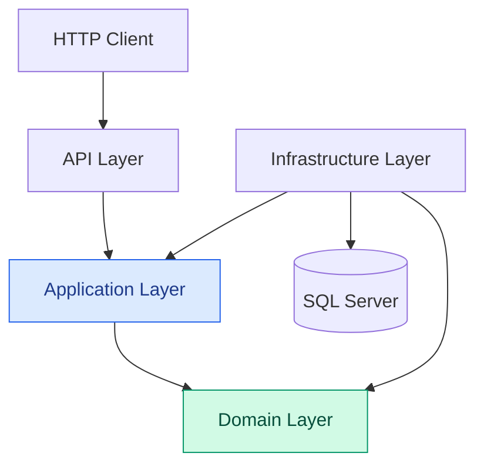
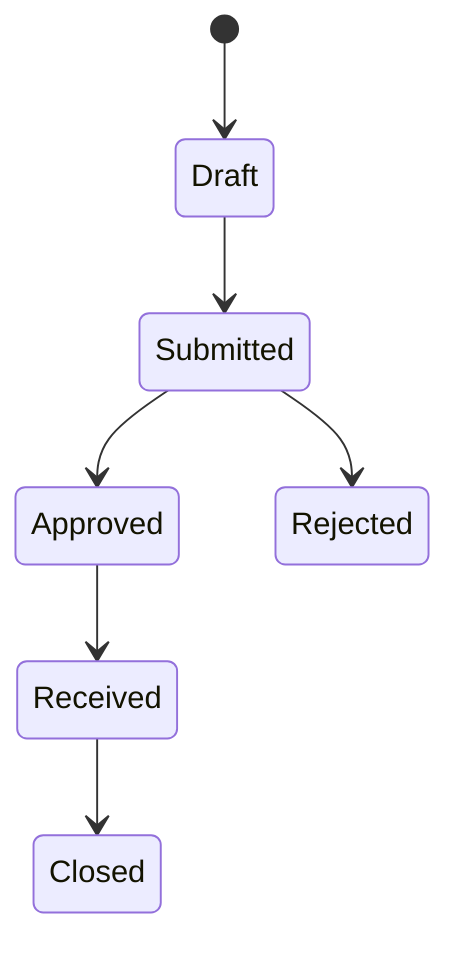

# Procurement and Inventory Management API

**An enterprise-grade backend API for procurement workflows and inventory control, built with .NET, Clean Architecture, Domain-Driven Design, and strict domain invariants.**

<p align="center">
  
  
  
  
</p>

<p align="center">
  
  
  
  
</p>

---

## Table of Contents

- [Overview](#overview)
- [Business Value](#business-value)
- [Architecture](#architecture)
- [Domain-Driven Design Highlights](#domain-driven-design-highlights)
  - [Auditable Entity](#1-auditable-entity)
  - [Rich Purchase Order Aggregate](#2-rich-purchase-order-aggregate)
  - [Purchase Order State Machine](#3-purchase-order-state-machine)
  - [Inventory Ledger Pattern](#4-inventory-ledger-pattern)
  - [Product Reorder Intelligence](#5-product-reorder-intelligence)
- [Application Layer](#application-layer)
- [Technology Stack](#technology-stack)
- [Getting Started](#getting-started)
- [Database Setup](#database-setup)
- [Running the API](#running-the-api)
- [Engineering Principles](#engineering-principles)
- [Future Enhancements](#future-enhancements)
- [License](#license)

---

## Overview

The **Procurement and Inventory Management API** is a backend system designed to manage the complete lifecycle of purchase orders and maintain reliable, auditable inventory records.

Rather than treating procurement as a collection of basic CRUD operations, the system models business processes explicitly. Domain entities encapsulate business rules, state transitions are validated before execution, and inventory movements are represented through an append-only transaction ledger.

The solution follows **Clean Architecture / Onion Architecture** principles, separating business logic from persistence and delivery mechanisms to improve maintainability, testability, and long-term extensibility.

### Core Capabilities

- **Purchase Order Lifecycle Management** — Manage purchase orders through controlled business states, from draft creation to submission, approval, rejection, receipt, and closure.
- **Domain-Level Validation** — Enforce business rules inside domain entities instead of relying exclusively on API-level or database-level validation.
- **Auditable Inventory Movements** — Represent stock receipts and adjustments as individual inventory transactions.
- **Product Reorder Monitoring** — Calculate reorder requirements from stock availability and configurable reorder thresholds.
- **Supplier Management** — Maintain supplier information as part of the procurement domain.
- **Decoupled Application Services** — Separate use-case orchestration from domain behavior and persistence implementation.
- **Controlled Data Exposure** — Use Data Transfer Objects (DTOs) to shape API responses without exposing persistence entities directly.

## Business Value

| Business Challenge | Architectural Solution |
|---|---|
| Invalid purchase order transitions | Explicit state machine and guarded domain operations |
| Inconsistent business rules | Rich domain models and protected domain invariants |
| Difficult inventory reconciliation | Append-only inventory transaction ledger |
| Accidental exposure of internal entities | DTO-based request and response contracts |
| Tight coupling to database infrastructure | Repository abstractions and dependency inversion |
| Limited traceability of record changes | Shared auditing metadata |
| Manual identification of low-stock products | Computed reorder indicators |

The result is a foundation for a maintainable procurement platform where business rules are explicit, operations are traceable, and the codebase can evolve without coupling the domain to the API or database.

---

## Architecture

The solution is organized into four independent projects following the principles of **Clean Architecture and Onion Architecture**.

The central rule is dependency direction: **business rules should not depend on infrastructure details.**

### Solution Structure

```text
ProcurementInventory/
│
├── Domain/
│   ├── Common/
│   │   └── AuditableEntity.cs
│   ├── Entities/
│   │   ├── PurchaseOrder.cs
│   │   ├── Product.cs
│   │   ├── Supplier.cs
│   │   └── InventoryTransaction.cs
│   ├── Enums/
│   │   └── PurchaseOrderStatus.cs
│   └── Workflows/
│       └── PurchaseOrderWorkflow.cs
│
├── Application/
│   ├── Abstractions/
│   │   └── IApplicationDbContext.cs
│   ├── Interfaces/
│   │   └── Repositories/
│   ├── DTOs/
│   └── Services/
│       └── ProductService.cs
│
├── Infrastructure/
│   ├── Persistence/
│   │   ├── ApplicationDbContext.cs
│   │   ├── Configurations/
│   │   └── Migrations/
│   ├── Repositories/
│   └── DependencyInjection.cs
│
├── API/
│   ├── Controllers/
│   ├── Middleware/
│   ├── Program.cs
│   └── appsettings.json
│
└── README.md
```

*The tree illustrates the intended organization; adjust directory and file names to match the actual solution.*

### The Four Layers

#### 1. Domain — The Business Core

Contains the core business entities, domain rules, value calculations, and workflow constraints.

Responsibilities:

- Model procurement and inventory concepts.
- Encapsulate business behavior in rich domain entities.
- Enforce invariants through guard clauses.
- Define valid purchase order state transitions.
- Remain independent of Entity Framework Core, SQL Server, and HTTP.

The Domain layer is the center of the architecture and has no dependency on the outer layers.

#### 2. Application — Use Cases and Orchestration

Defines how application operations are executed without owning the underlying business rules or database implementation.

Responsibilities:

- Expose abstractions such as `IApplicationDbContext`.
- Define repository contracts such as `IProductRepository`.
- Coordinate operations through application services.
- Validate application-level requirements.
- Map domain results into DTOs.
- Depend on Domain rather than Infrastructure.

#### 3. Infrastructure — Persistence and External Concerns

Implements the technical details required by the application.

Responsibilities:

- Implement `IApplicationDbContext`.
- Configure Entity Framework Core mappings.
- Implement repository interfaces.
- Manage SQL Server persistence and schema migrations.
- Register infrastructure services through dependency injection.

Infrastructure depends inward on the abstractions and domain concepts it implements.

#### 4. API — The Entry Point

Exposes application functionality through HTTP endpoints.

Responsibilities:

- Handle incoming HTTP requests.
- Bind and validate request data.
- Invoke application services.
- Return appropriate HTTP responses.
- Configure dependency injection and application middleware.

The API acts as the delivery mechanism, not the place where core business rules live.

### Dependency Flow



Infrastructure implements abstractions defined by the inner layers. Dependency injection connects these implementations at runtime without forcing the Domain or Application layers to depend on concrete database implementations.

---

## Domain-Driven Design Highlights

The domain model is designed around business behavior rather than passive data containers.

The project applies selected **Domain-Driven Design (DDD)** principles, including rich domain models, aggregate roots, explicit invariants, and domain-oriented workflow rules.

### 1. Auditable Entity

`AuditableEntity` is an abstract base class that centralizes common identity and auditing metadata for inheriting entities.

| Property | Purpose |
|---|---|
| `Id` | Identifies the entity |
| `CreatedBy` | Identifies the creator |
| `CreatedOn` | Records when the entity was created |
| `ModifiedBy` | Identifies the most recent modifier |
| `ModifiedOn` | Records the most recent modification time |

Centralizing these fields promotes consistency and reduces duplication across the domain model.

Auditing metadata also provides a foundation for investigating changes and supporting operational traceability.

> Audit-field population should be implemented consistently, for example through a centralized persistence mechanism or an application-level auditing service.

### 2. Rich Purchase Order Aggregate

`PurchaseOrder` is the **Aggregate Root** responsible for protecting the consistency of purchase order operations.

It is more than a database entity containing getters and setters. It encapsulates business behavior, calculated values, and state-dependent rules.

#### Key Responsibilities

- Maintain the purchase order's status.
- Calculate the order's `Total` from its line items.
- Control submission, approval, rejection, receipt, and closure.
- Prevent operations that violate the business lifecycle.
- Ensure that invalid operations fail before inconsistent state is accepted.

#### Example: Guarded Approval

The following snippet illustrates the intended domain behavior. Adapt the property names and workflow integration to the actual implementation.

```csharp
public void Approve()
{
    PurchaseOrderWorkflow.EnsureCanTransition(
        Status,
        PurchaseOrderStatus.Approved);

    Status = PurchaseOrderStatus.Approved;
}
```

The important design decision is that approval is expressed as a domain operation rather than an unrestricted status update.

The workflow validates whether the transition is legal before the aggregate changes its state.

**Why this matters:** callers cannot legitimately approve a draft order merely by setting a property. The operation must satisfy the domain's transition rules.

### 3. Purchase Order State Machine

`PurchaseOrderWorkflow` is a dedicated state machine implemented using a static dictionary of permitted transitions.

Instead of scattering status checks throughout controllers and services, the workflow centralizes the legal lifecycle transitions.

#### Conceptual State Flow



This diagram represents an illustrative lifecycle. The actual workflow dictionary is the source of truth for supported transitions.

#### Transition Rules

| Current State | Allowed Next State |
|---|---|
| Draft | Submitted |
| Submitted | Approved, Rejected |
| Approved | Received |
| Received | Closed |

The workflow rejects transitions not explicitly permitted by the configured rules.

#### Example: Workflow Dictionary

```csharp
private static readonly Dictionary<
    PurchaseOrderStatus,
    HashSet<PurchaseOrderStatus>> AllowedTransitions = new()
{
    [PurchaseOrderStatus.Draft] =
        [PurchaseOrderStatus.Submitted],

    [PurchaseOrderStatus.Submitted] =
    [
        PurchaseOrderStatus.Approved,
        PurchaseOrderStatus.Rejected
    ],

    [PurchaseOrderStatus.Approved] =
        [PurchaseOrderStatus.Received],

    [PurchaseOrderStatus.Received] =
        [PurchaseOrderStatus.Closed]
};
```

This example uses C# collection expressions and assumes the corresponding enum members exist. It illustrates the design rather than guaranteeing an exact match with the repository implementation.

The `EnsureCanTransition` operation checks the current state against the permitted transition set and rejects invalid changes.

#### Benefits

- Centralized workflow rules.
- Consistent transition validation.
- Fewer duplicated conditional checks.
- Easier testing of valid and invalid lifecycle operations.
- Clearer separation between business policy and API endpoints.

### 4. Inventory Ledger Pattern

Inventory is tracked through `InventoryTransaction` records rather than relying exclusively on a mutable stock-receipt table.

Every supported stock movement is represented by a transaction containing a `QuantityChange` and the relevant transaction metadata.

Typical transaction types include:

- **Receipt:** Records an increase in stock.
- **Adjustment:** Records a correction to inventory quantities.

#### Conceptual Example

| Transaction | Quantity Change | Running Stock |
|---|---:|---:|
| Initial balance | +100 | 100 |
| Purchase receipt | +25 | 125 |
| Inventory adjustment | -5 | 120 |
| Additional receipt | +40 | 160 |

The running stock in this example is illustrative.

#### Why Use a Ledger?

**Traceability:** Each movement has an individual record that can be inspected during reconciliation.

**Auditability:** Historical movements can be reviewed without relying solely on the current stock value.

**Clearer business intent:** Receipts and adjustments are explicit operations rather than arbitrary changes to a quantity field.

**Reconciliation potential:** Transaction history provides a foundation for investigating discrepancies and reconstructing stock balances.

A ledger-based model does not automatically guarantee correctness or performance. The application must also enforce transaction validation, atomic persistence, and appropriate database constraints.

For example, when an inventory transaction is recorded, the system should ensure that the corresponding stock effects are applied consistently and that concurrent operations cannot silently produce invalid balances.

### 5. Product Reorder Intelligence

`Product` encapsulates product-related inventory information and computes whether the product requires replenishment.

The `NeedsReorder` property derives its value from the current stock level and the configured reorder threshold.

Conceptually:

```csharp
public bool NeedsReorder =>
    StockOnHand <= ReorderThreshold;
```

The comparison above assumes that the business rule triggers replenishment when stock is equal to or below the threshold. Adjust the comparison if the actual implementation uses a different rule.

This computed property avoids storing a redundant boolean that could become inconsistent with the underlying quantities.

It provides a simple foundation for low-stock alerts, procurement recommendations, and inventory monitoring.

### 6. Supplier Management

`Supplier` represents a core procurement concept and provides the supplier information required by the purchase order workflow.

Keeping supplier data within the domain model allows the application to evolve toward additional procurement capabilities without placing supplier-specific rules in API controllers.

---

## Application Layer

The Application layer coordinates use cases while keeping the business domain independent of infrastructure implementation details.

### Abstraction and Dependency Inversion

Interfaces such as `IApplicationDbContext` and repository contracts such as `IProductRepository` define what the application needs without prescribing how data is persisted.

```csharp
public interface IProductRepository
{
    // Define product persistence operations here.
}
```

This interface is illustrative; replace the comment with the actual repository contract when documenting the implementation.

Infrastructure supplies the concrete implementation and registers it with the dependency injection container.

This arrangement supports isolated unit testing and reduces the cost of changing persistence details.

### Application Services

Services such as `ProductService` coordinate product-related use cases.

Responsibilities include:

- Validating SKU uniqueness.
- Coordinating repository operations.
- Retrieving product information.
- Mapping domain entities to `ProductDto` objects.
- Returning application-level results without exposing raw database entities.

### DTO-Based Data Contracts

Data Transfer Objects provide explicit boundaries between internal domain models and external API contracts.

For example, a `ProductDto` can expose the product information required by a client without exposing internal persistence details or auditing fields that should remain private.

Benefits include:

- Controlled data exposure.
- Stable API response contracts.
- Reduced coupling between clients and persistence entities.
- Easier response shaping and API evolution.

DTOs complement authorization and validation; they do not replace them.

---

## Technology Stack

| Technology | Version | Purpose |
|---|---|---|
| .NET | 10.0 | Application runtime and platform |
| C# | 12 as specified | Language features and domain implementation |
| Entity Framework Core | 10.0 | ORM and Code-First persistence |
| Microsoft SQL Server | Compatible supported release | Relational database |
| Dependency Injection | .NET built-in DI | Runtime dependency resolution |
| REST API | HTTP | Application access and integration |

**Version compatibility note:** .NET 10 and Entity Framework Core 10 are designed for the same platform generation. However, .NET 10's SDK/compiler defaults to a newer C# language version than C# 12. If the project explicitly targets C# 12, verify that the selected SDK and `LangVersion` configuration support the intended combination.

---

## Getting Started

Follow these steps to configure and run the API locally.

### Prerequisites

Install the following tools:

- [.NET 10 SDK](https://dotnet.microsoft.com/download/dotnet/10.0)
- [Microsoft SQL Server](https://www.microsoft.com/sql-server) or a compatible local SQL Server instance
- [SQL Server Management Studio (SSMS)](https://learn.microsoft.com/sql/ssms/download-sql-server-management-studio-ssms)
- [Git](https://git-scm.com/)
- Entity Framework Core CLI tools

Verify the installed SDK:

```bash
dotnet --version
```

Install the EF Core CLI tool if it is not already available:

```bash
dotnet tool install --global dotnet-ef --version 10.*
```

If the tool is already installed, update it when necessary:

```bash
dotnet tool update --global dotnet-ef --version 10.*
```

### 1. Clone the Repository

```bash
git clone <YOUR_REPOSITORY_URL>
cd <YOUR_REPOSITORY_DIRECTORY>
```

Replace the placeholders with your actual Git repository URL and solution directory.

### 2. Configure the Database Connection

Open the API project's `appsettings.json` file and configure the SQL Server connection string.

Example:

```json
{
  "ConnectionStrings": {
    "DefaultConnection": "Server=localhost;Database=ProcurementInventoryDb;Trusted_Connection=True;TrustServerCertificate=True;"
  }
}
```

This example assumes a local SQL Server instance using Windows Authentication.

For a named SQL Server instance, replace `localhost` with the appropriate server and instance name. For SQL Server authentication, use the appropriate credentials and secure configuration.

**Security recommendations:**

- Never commit production credentials or passwords to source control.
- Prefer .NET User Secrets for local development credentials.
- Use environment variables or a managed secret store in deployed environments.
- Configure TLS and certificate validation appropriately for your environment.

For local development, User Secrets can be initialized from the API project directory:

```bash
dotnet user-secrets init
dotnet user-secrets set "ConnectionStrings:DefaultConnection" "<YOUR_CONNECTION_STRING>"
```

Ensure the configured connection string key matches the one used by the application's database registration.

### 3. Restore Dependencies

From the solution directory:

```bash
dotnet restore
```

### 4. Build the Solution

```bash
dotnet build
```

Resolve any build errors before proceeding with database migrations.

---

## Database Setup

The project uses **Entity Framework Core Code-First** to manage the database schema through migrations.

The Domain model and EF Core configurations define the intended persistence structure, while migrations capture schema changes over time.

### Install or Verify EF Core Tools

```bash
dotnet ef --version
```

Ensure that the EF Core CLI major version matches the project's EF Core version.

### Apply Existing Migrations

If the solution uses `API` as its startup project and `Infrastructure` as its migrations project, run the following from the solution root:

```bash
dotnet ef database update \
  --project Infrastructure/Infrastructure.csproj \
  --startup-project API/API.csproj
```

This command assumes the project and file names shown in the example tree. Replace them with the actual `.csproj` paths in your repository.

The startup project must be configured to load the correct database connection string and register the required services.

### Create a New Migration

When the model changes and a new migration is required:

```bash
dotnet ef migrations add InitialCreate \
  --project Infrastructure/Infrastructure.csproj \
  --startup-project API/API.csproj
```

Use `InitialCreate` only when creating the initial migration. For subsequent schema changes, choose a descriptive name such as `AddInventoryTransactionMetadata`.

Then apply the migration:

```bash
dotnet ef database update \
  --project Infrastructure/Infrastructure.csproj \
  --startup-project API/API.csproj
```

**Important:** If the repository already contains migrations, apply those migrations instead of generating a duplicate initial migration.

---

## Running the API

From the solution root, launch the API project:

```bash
dotnet run --project API/API.csproj
```

Alternatively, enter the API project directory:

```bash
cd API
dotnet run
```

The application will print the local URLs it is listening on.

If Swagger/OpenAPI is configured and enabled in the current environment, open the displayed Swagger UI URL in your browser to explore the available endpoints.

The exact endpoint routes, port numbers, authentication requirements, and Swagger configuration depend on the actual API implementation.

### Development Workflow

A typical local development workflow is:

1. Update a domain entity or business rule.
2. Implement or update the corresponding application use case.
3. Update Infrastructure mappings or migrations if persistence changes.
4. Expose or update an API endpoint when needed.
5. Build and test the solution.
6. Apply the appropriate database migration.
7. Run the API and verify the behavior.

---

## Engineering Principles

The project emphasizes the following engineering principles:

- **Separation of Concerns:** Business rules, use cases, persistence, and HTTP delivery are isolated in distinct layers.
- **Dependency Inversion:** Application code depends on abstractions instead of concrete infrastructure implementations.
- **Domain Integrity:** Rich entities protect business invariants through explicit operations and guard clauses.
- **Explicit Workflow Modeling:** Purchase order transitions are governed by centralized business rules.
- **Auditability:** Inventory movements are represented as individual ledger transactions.
- **Contract-Based API Design:** DTOs provide controlled request and response shapes.
- **Maintainability:** The architecture supports independent evolution of domain logic and technical implementation.
- **Testability:** Interfaces and isolated domain behavior provide clear seams for unit and integration testing.

## Future Enhancements

The architecture provides a foundation for future capabilities such as:

- Automated unit and integration test suites.
- Role-based authorization for procurement operations.
- Optimistic concurrency control for inventory updates.
- Transactional guarantees for purchase order receipts and stock movements.
- Structured logging, tracing, and health checks.
- CI/CD pipelines and automated migration validation.
- Inventory reconciliation reports and low-stock notifications.
- API versioning and standardized error responses.
- Idempotency safeguards for retryable inventory operations.

These are potential enhancements, not claims that the features are already implemented.

---

## License

No license has been specified yet.

If you intend to distribute the project as open source, add an appropriate `LICENSE` file and replace this section with the selected license and attribution details.

---

<p align="center">
  <strong>Built with .NET and a domain-first approach to procurement and inventory management.</strong>
</p>
